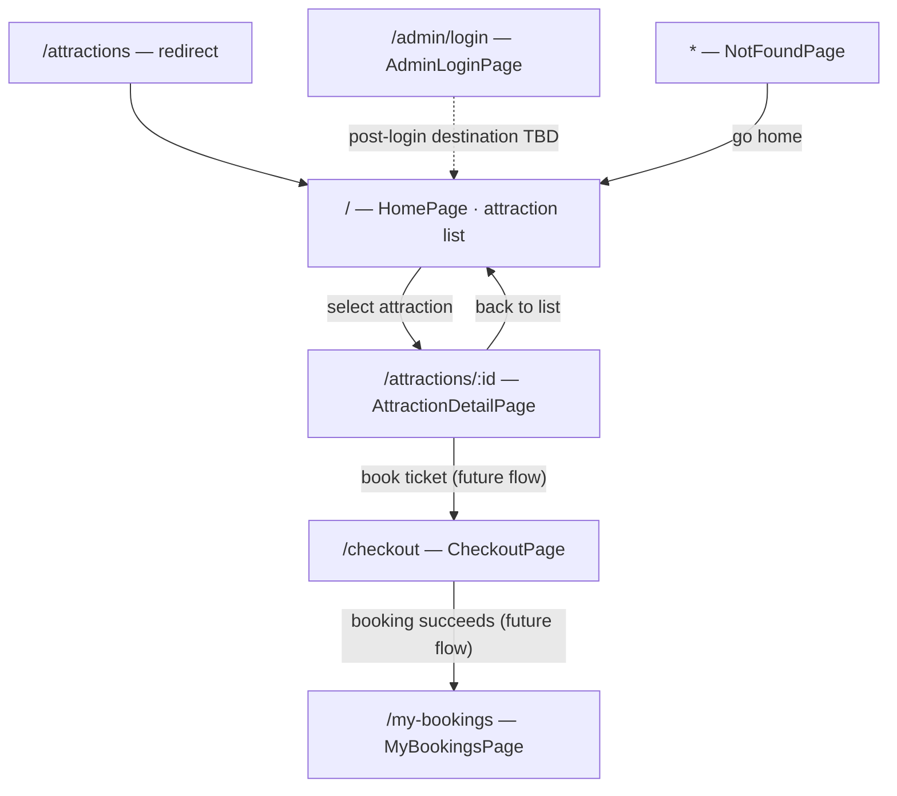

# Route specification

## Source and assumptions

`docs/PRD.md` is not present in the repository. This draft is based on the routes
currently declared in `src/app/routes.tsx` and the existing route notes in
`src/types/docs/ROUTES.md`. Access control, authoritative data sources, and
post-action destinations not implemented or specified there are marked as
pending product confirmation; the table must be reconciled with the PRD when it
is added.

All routes are currently reachable without an authorization guard. A reusable
`ProtectedRoute` component is available for future use but is not attached to
any route until the application has a defined authentication source and the
product specifies which routes require access control. “Public” below describes
the current implementation, not a security decision.

## Route inventory

| Path | Screen / behavior | Access | Data | State and behavior | Next path |
| --- | --- | --- | --- | --- | --- |
| `/` | `HomePage` — list of attractions | Public; no route guard | Local fixture in `src/data/attractions.ts`, typed as `DiaDanh` | Renders the populated list synchronously; shows an empty-state message if the fixture is empty. Selecting a card opens its detail. | `/attractions/:id` |
| `/attractions/:id` | `AttractionDetailPage` — attraction details | Public; no route guard | `id` path parameter; looks up the record in the shared local fixture | Parses and validates `id` as a positive safe integer. Renders matching details or a not-found state with a link to the list. | `/` |
| `/attractions` | Redirect to `/` using `Navigate` with `replace` | Public | None | Replace the current history entry with the home route. | `/` |
| `/checkout` | `CheckoutPage` — confirm a ticket booking | Public; no route guard | Existing route note requires `location.state.attractionId`; booking data contract otherwise unspecified | Handle missing or invalid navigation state explicitly. Booking persistence and confirmation behavior require PRD definition. | `/my-bookings` after a successful booking; exact flow pending PRD |
| `/my-bookings` | `MyBookingsPage` — booking history | Public; no route guard | Booking history source and ownership rules are unspecified | Current page is static. Authentication, empty, loading, and error behavior need PRD definition. | Destination is unspecified |
| `/admin/login` | `AdminLoginPage` — administrator sign-in | Public sign-in entry point | Credentials/authentication provider unspecified | Current page is static; validation, failure, and session behavior need PRD definition. | Successful-login destination is unspecified |
| `*` | `NotFoundPage` — route not found | Public | Requested URL | Display a 404 state for unmatched paths. | `/` |

## Sprint 1 navigation flow

## Route implementation conventions

- Keep route definitions in `src/app/routes.tsx` and browser-router creation in
  `src/app/router.tsx`.
- Use `react-router` v8 APIs; do not import from `react-router-dom`.
- Render the shared application shell through `RootLayout` and its `<Outlet />`.
- Treat route params and navigation state as untrusted input and handle missing,
  malformed, or unknown values in the destination screen.
- When protection is required, wrap child routes with `ProtectedRoute` and pass
  an explicit authorization decision. Do not infer authentication from the
  presence of a hidden menu link or hard-code a logged-in state.

## Sprint 1 verification

- Verified in the browser: `/` renders the three attraction cards; selecting
  “Đại Nội Huế” opens `/attractions/1` with matching details; the detail page
  links back to `/`.
- Verified an unknown attraction ID shows the not-found state.
